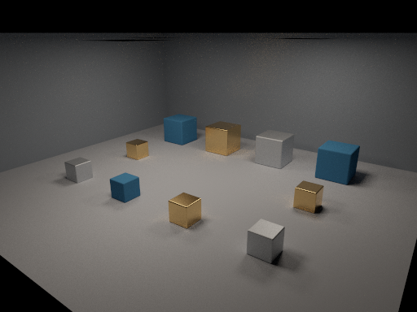
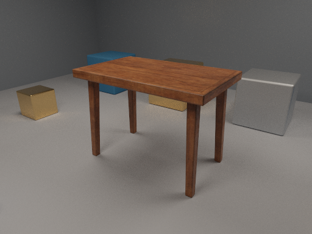
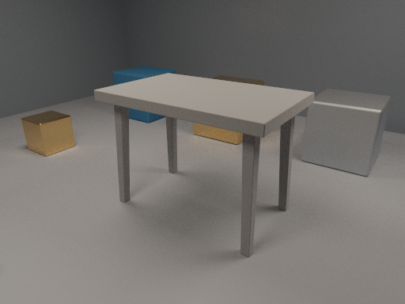

# 更大的场景、外部模型与 PBR 材质

2026-11-13，已完成桌面实现与验证。按[资源与规范](../reading/assets-gltf.md) → [实现计划](../plans/asset-gallery.md) → 实现验证 → 本页回填推进。

## 实际画面

Gallery 地面从 Cornell 的约 2 × 2 扩为 16 × 14，加入背景墙、三盏面积光源和不同材质的测试物体。中央留给外部模型，移动速度提高到原来的四倍。



下面是下载的 [Poly Haven Wooden Table 02](https://polyhaven.com/a/wooden_table_02)，使用其 1K glTF 与贴图，授权为 [CC0](https://polyhaven.com/license)。两图均为 RTX 4070 SUPER、512 × 384、512 spp、最多八次散射、模型缩放 2.5、种子 7。

| 模型携带的 PBR 贴图 | 仅使用材质因子 |
| --- | --- |
|  |  |

CPU 解析资源、创建场景并提交任务；UV 插值、贴图采样、BRDF、遮挡与路径累积在 Vulkan Compute Shader + Ray Query 中执行。

## 网站与格式

| 来源 | 推荐用途 | 下载选择 |
| --- | --- | --- |
| [Poly Haven](https://polyhaven.com/models) | 写实家具、道具与表面 | 本轮木桌选 glTF、1K，保留 `.gltf`、`.bin` 和 `textures/`。其他资产按页面选择 glTF、FBX、Blender 等格式。 |
| [Kenney](https://kenney.nl/assets) | 成套低多边形游戏资产 | 优先 GLB；[官方说明](https://kenney.nl/knowledge-base/game-assets-3d/importing-3d-models-into-game-engines)确认其 glTF 以 GLB 分发。 |
| [ambientCG](https://ambientcg.com/) | 地面、墙面、木材等独立材质 | 例如 [Wood Floor 051](https://ambientcg.com/view?id=WoodFloor051)提供 JPG / PNG 贴图 ZIP，还需分配到网格 UV 和材质槽。 |

当前接 glTF / GLB metallic-roughness 材质。FBX、OBJ、Blender 源文件需先转换；独立贴图包的任意材质槽覆盖界面待接入。`.gltf` 必须保留外部依赖。

`assets/manifest.json` 保存下载地址、来源、授权与 SHA256。`tools/download-sample-assets.ps1` 补下载缺失文件并验证已有文件，不自动覆盖不匹配文件。资产与构建依赖分别下载，CTest 使用自建资产，无需联网。

## 实现与边界

- 支持静态不透明三角形、默认场景、层级节点、多个 primitive、网格实例、索引／无索引网格、法线和 UV0。节点用完整世界变换，法线用逆转置。
- 基础色／金属度／粗糙度因子；PNG/JPEG 的基础色、MR、切线空间法线与发光贴图。基础色和发光按 sRGB 解码，其余按线性读取；MR 的 G 为粗糙度、B 为金属度。[规范](https://registry.khronos.org/glTF/specs/2.0/glTF-2.0.html#materials)
- Lambert 与 GGX 使用一致的混合 PDF。保留旧 Cornell 漫反射与导体分支。
- 图片保持原尺寸，GPU 缓冲区保存 RGBA8；颜色纹素先转线性再双线性插值，支持 repeat / clamp / mirrored-repeat。尚无 mipmap、各向异性或压缩纹理，所有过滤配置暂用基础级双线性。
- 法线基底由世界空间边与 UV0 计算，再正交化到插值法线；尚未使用资产携带的切线或 MikkTSpace，复杂接缝待验证。
- 面板新增 **Gallery / Models** 和 **Open model (.gltf / .glb)**。已实际通过文件选择器载入木桌，确认视口显示木纹并重新累积。加载失败恢复旧设置并显示原因。

不透明表面沿用双面着色。透明／alpha mask、动画、蒙皮、morph、顶点色、UV1、纹理变换、压缩网格和大部分材质扩展会报错；必需扩展尚不支持。发光表面沿用发光命中后终止路径的处理，导入发光网格暂未加入 NEE 列表。本轮不声称完整支持 glTF 显示规范。

AO 不直接乘入路径追踪光照，避免重复压暗已追踪的几何遮挡；样例 ARM 图只读取粗糙度和金属度。外部模型使用完整路径积分器，空间复用保留在独立实验场景。

Gallery 为 2 个共享网格、11 个实例、9,732 个世界空间着色三角形。加木桌后为 3 个网格、12 个实例、9,928 个着色三角形、8 个材质槽（含默认槽）、3 张 1024² 贴图。纹理缓冲区 12,582,960 字节，约 12 MiB。

代码入口为 `src/core/gltf.cpp`、共享场景、`shaders/pathtrace_common.glsl`、`shaders/pathtrace.comp`、Vulkan 后端与桌面面板。GpuTriangle 为 144 字节，GpuMaterial 为 64 字节，push constant 保持 128 字节。

## 验证结果

| 检查 | 结果 |
| --- | --- |
| 七项 CTest | 原五项，加 CPU 资产导入与 GPU GLB 几何，全部通过 |
| 同一场景 glTF / GLB | 128 spp 线性 RGB 最大差为 0 |
| 木桌 65 × 49 GPU 几何 | CPU 主射线 oracle：0 个不一致像素 |
| 节点、负缩放与 PNG | 实例、父子变换、法线、UV、外部／内嵌资源检查通过 |
| 木桌 16,384 spp，MIS / 独立种子 BSDF-only | 整体平均能量比 0.99933，中心固定区域 0.99714 |
| 新模型累积状态 | 相机失效、重放、曝光保留历史、采样上限通过 |
| 原材质 MIS / BSDF 能量 | 漫反射 1.00545、粗糙金属 0.98303、光滑金属 0.98198，均在原 3% 阈值内 |
| 原 balance 空间实验 | 与上轮同种子 PFM 最大 RGB 差为 0 |
| Vulkan API / 同步验证 | 此轮日志没有验证错误 |

木桌收敛使用 96 × 96、种子 97，以另一种子的 16,384 spp BSDF-only 图为参考。整体亮度 RMSE：8 spp 为 0.06485、64 spp 为 0.02393、512 spp 为 0.01190。中心区域为 `x=[32,65), y=[25,36)`，参考仍有采样噪声。

范围为 Windows / RTX 4070 SUPER；本轮未做 Android 构建、手机资产加载或其他 GPU 验收，也未用小型木桌证明大型生产场景性能。

## 运行与续接

```powershell
./tools/bootstrap.ps1
./tools/download-sample-assets.ps1
./tools/build.ps1 -Test
./build/Release/raytrace.exe --scene gallery
./build/Release/raytrace.exe --model assets/wooden_table_02/wooden_table_02_1k.gltf --model-scale 2.5
$env:VK_LAYER_PATH=(Resolve-Path tools/local/validation).Path
$env:VK_LAYER_VALIDATE_SYNC='1'
python tests/validate_assets.py build/Release/raytrace.exe
```

打开模型时自动切换 Gallery 并取景；指定相机位置或朝向后关闭自动取景。`--model-x/y/z` 设置位置，`--model-yaw` 设置角度，`--model-scale` 设置正数缩放。`--no-model-textures` 用于材质因子对照。

展示图生成命令：

```powershell
./build/Release/raytrace.exe --headless --model assets/wooden_table_02/wooden_table_02_1k.gltf --model-scale 2.5 --width 512 --height 384 --spp 512 --samples-per-frame 8 --max-bounces 8 --light-sampling power --self-test --output output/assets/table-textured.png
```

原始图像、参数和日志在 `output/assets/`，自动统计在 `output/assets/validation/results.json`。后续优先用用户挑选的实际资产扩充场景，再按需求加入独立材质覆盖、切线／mipmap 与资源性能优化。
