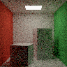
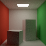

# Cornell Box 光源采样与 MIS

在相同的每像素样本数下，把直接光源采样和 BSDF 采样合起来，能把亮度误差降多少？这里用同一台 GPU、同一个 Cornell Box 和相同的反弹上限比较两种积分器。

| 仅 BSDF 采样 · 512 spp | 光源采样 + BSDF 采样（MIS）· 512 spp |
| --- | --- |
|  |  |

## 两种方式采到同一条光路

只采 BSDF 时，路径从表面散射出去，射线碰巧打到光源才会积累该段的发光贡献。对小面积光源，很多方向都采不到光。显式光源采样（Next Event Estimation，NEE）在光源表面直接抽一个点，再用阴影射线判断它是否可见。两条路径都能估计同一项直接光照，因此用多重重要性采样（MIS）给它们分配权重。

对单个均匀采样的矩形光源，面积为 $A$，表面点到采样点的距离为 $r$，$\theta_L$ 是光源法线与指向表面方向的夹角。用 $d\omega=\cos\theta_L\,dA/r^2$ 把面积 PDF 换成立体角 PDF：

$$
p_L(\omega)=\frac{1}{A}\frac{r^2}{\cos\theta_L}, \qquad \cos\theta_L>0.
$$

漫反射使用余弦加权采样，$p_B(\omega)=\cos\theta_s/\pi$，其中 $\theta_s$ 是散射方向与表面着色法线的夹角。两个 PDF 都按立体角计量。每种方法取一个样本时，power heuristic 的权重为：

$$
w_L(\omega)=\frac{p_L(\omega)^2}{p_L(\omega)^2+p_B(\omega)^2}, \qquad
w_B(\omega)=\frac{p_B(\omega)^2}{p_L(\omega)^2+p_B(\omega)^2}.
$$

同一方向上的两个权重相加为 1。直接采到光源时乘 $w_L$，BSDF 延伸射线命中光源时乘 $w_B$。[PBRT 第四版 · A Better Path Tracer](https://pbr-book.org/4ed/Light_Transport_I_Surface_Reflection/A_Better_Path_Tracer)

## 对照实现

| 代码入口 | 对应步骤 |
| --- | --- |
| `lightPdf` | 用距离平方和光源侧余弦换算光源 PDF。 |
| `evaluateBsdf` | 计算 BSDF 值和反射方向的 PDF。 |
| `integrate` | 显式光源采样通过 `traceAny` 检查遮挡。BSDF 命中发光面时，用上一交点和上一方向的 PDF 计算另一半 MIS 权重。相机直接看见光源时权重为 1。 |

这些函数在 `shaders/pathtrace.comp`。`tests/validate_integrator.py` 负责收敛和能量验证，`tests/compare_radiance.py` 负责读取线性 PFM 并计算亮度误差。

## 复现实验

在项目根目录运行。需要已构建的 Windows Release 程序和支持 Vulkan Ray Query 的 GPU。

```powershell
python tests/validate_integrator.py build/Release/raytrace.exe --output output/knowledge-mis

$settings = @('--headless', '--width', '96', '--height', '96', '--spp', '512',
    '--samples-per-frame', '16', '--max-bounces', '8', '--seed', '7', '--self-test')
& ./build/Release/raytrace.exe @settings --bsdf-only --output output/knowledge-mis/bsdf-512.pfm

python tests/compare_radiance.py output/knowledge-mis/reference.pfm output/knowledge-mis/bsdf-512.pfm
python tests/compare_radiance.py output/knowledge-mis/reference.pfm output/knowledge-mis/mis-512.pfm
```

回归脚本生成 4096 spp、独立随机种子的 MIS 参考图，以及 8、64、512 spp 的 MIS 样本。比较脚本在参考图的亮度掩码内计算 RMSE 和平均亮度比。这里共比较 9076 个像素，掩码会去掉直接可见的高亮发光面与低于阈值的暗像素。要导出顶部的显示图，可用相同的渲染参数分别导出 PNG，两次运行分别启用和省略 `--bsdf-only`。

## 本机结果

RTX 4070 SUPER，96 × 96，512 spp，反弹上限 8。两种估计器使用相同的初始种子，参考图使用独立种子。

| 估计器 | 线性亮度 RMSE | 平均亮度 / 参考图 |
| --- | ---: | ---: |
| 仅 BSDF 采样 | 0.05383 | 0.99837 |
| 光源 + BSDF，MIS | 0.00693 | 1.00073 |

这组对照中，两种方法的平均亮度都接近参考图，MIS 的亮度 RMSE 约为仅 BSDF 采样的 **1/7.8**。比较预算是 spp。显式光源采样需要额外的遮挡查询，要评估相同 GPU 时间下的收益，需要另测耗时与误差。[Cornell Box 回归验证](../validation-cornell.md)
