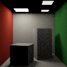
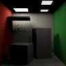
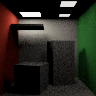

# Cornell Box 多光源采样实验

在几乎相同的阴影射线数下，**按发射功率选灯让两组场景的整体 RMSE 分别下降约 41% 和 28%，却让挡板阴影区域的 RMSE 上升约 37%**。全局指标和局部阴影给出了不同答案。

实验要回答的问题是：阴影射线预算有限时，把更多采样机会分给功率大的灯，能否降低直接光照的噪声？[按功率选灯解决什么问题](../reading/many-light-sampling.md#按功率选灯解决什么问题)

## 渲染对照

同一相机、128 spp、一次散射、种子 7。顶部三盏面光源中，两盏暗灯共用发光材质。

| 场景 | 均匀选灯 | 按发射功率选灯 |
| --- | --- | --- |
| 三盏灯，未加挡板 |  |  |
| 顶部挡板遮挡最亮的灯 |  |  |

## 测量结果

Windows，RTX 4070 SUPER，96 × 96，一次散射。用 16,384 spp 的 BSDF-only 线性 PFM 作参考图，再用独立种子的 8,192 spp 图检查参考误差。表中是三组种子的中位数。整体指标使用参考图线性亮度在 0.001 到 2 之间的区域。局部指标只取画面下半部中亮度较无挡板参考图下降至少 40% 的 1,748 个像素。

| 场景 / 区域 | 均匀 RMSE | 按功率 RMSE（匹配射线数） | 均匀 / 按功率射线数 |
| --- | ---: | ---: | ---: |
| 无挡板 / 整体 | 0.03616 | 0.02117 | 783,661 / 781,073 |
| 有挡板 / 整体 | 0.02696 | 0.01930 | 761,524 / 760,947 |
| 有挡板 / 局部阴影 | 0.00336 | 0.00461 | 同上一行 |

均匀策略为 128 spp，按功率策略分别以 133 和 134 spp 匹配预算。候选在着色点或光源背面时会提前剔除，因此相同 spp 对应的实际阴影射线数可以相差约 4–5%。实验脚本使用实际计数，把每组种子的射线数差控制在 1% 内。

整体平均亮度比参考图偏差在 0.3% 内。参考图交叉检查的 RMSE 为 0.01593 和 0.01024，低于两种策略的整体误差。两种策略均为 128 spp、每次 dispatch 16 spp 时，未开启验证层的测量中，最后一次采样 dispatch 中位数约为 0.069–0.076 ms。这是单次 dispatch 的时间，等射线数的样本批次可能不完整，因此这里只比较批次大小相同的测量。

桌面 Release 和五项 CTest 通过。开启 Vulkan 同步验证复跑后，多灯的误差与射线计数一致，单灯 Cornell 的积分器统计也与原基线一致。

## 实现与经验

- 光源表在 `src/core/scene.cpp` 生成，`src/vulkan/renderer.cpp` 沿用现有 storage buffer 绑定上传。着色器 `shaders/pathtrace.comp` 由发光三角形查灯索引，因此两盏灯可以共用同一材质。显式光源采样和 BSDF 命中灯时都使用该灯的选中概率乘条件立体角 PDF。
- 在多光源场景，把每像素实际发出的 NEE 阴影射线数随辐亮度一起累积，写入 PFM 旁的元数据。遮挡查询返回被挡也算一次，提前拒绝的候选计零。计数跟着采样历史一起重置，无需增加全局原子计数。
- 这次按功率选灯约 88% 的机会给了最亮的灯。挡板削弱了亮灯对局部阴影的贡献，而按功率选灯又减少了落到两盏暗灯上的样本，这与局部噪声上升一致。后续比较 ReSTIR DI 时，保留同一遮挡区域和射线预算，分别看局部误差和平均亮度。[原文阅读笔记](../reading/many-light-sampling.md)

## 复现

在项目根目录运行：

```powershell
./tools/build.ps1 -Test
python tests/validate_integrator.py build/Release/raytrace.exe --output output/many-lights-single-regression
python tests/validate_many_lights.py build/Release/raytrace.exe
```

实验脚本把 PFM、运行日志和 `results.json` 写到 `output/many-lights/`。上面的 PNG 也可以用相同设置导出，例如：

```powershell
./build/Release/raytrace.exe --headless --scene many-lights-occluded --light-sampling power --width 96 --height 96 --spp 128 --samples-per-frame 16 --max-bounces 1 --seed 7 --self-test --output output/many-lights/occluded-power.png
```
