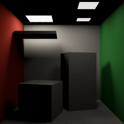

# Pairwise MIS：减少空间复用的交叉评价

普通 defensive Pairwise MIS 已完成。在四邻居、完整可见性和相同 128 spp 下，挡板场景的 NEE 阴影射线数相对 balance 减少 **42.4%**，完整采样 GPU 时间减少 **28.5%**，整体亮度 RMSE 增加 **0.49%**，阴影 RMSE 增加 **2.90%**。

本轮按[第五篇阅读笔记](../reading/restir-stochastic-pairwise.md) → [实现计划](../plans/pairwise-mis.md) → 桌面实现与验证 → 本页回填推进。实现的是固定邻域、等置信度的普通 defensive Pairwise MIS。2026 论文中的随机大邻域来源抽样、cell 列表与 canonical 权重的随机估计仍待后续研究。

## 要解决的问题

[空间基线](./spatial-reuse.md)对每个候选评价全部来源的目标函数，其中包括可见性查询。来源数为 $M$ 时，完整交叉评价的成本为 $O(M^2)$。Pairwise 把邻居分别与当前像素的 canonical 来源配对，评价次数降到 $O(M)$。[课程 §7.1.3，式 7.6–7.8](https://intro-to-restir.cwyman.org/presentations/2023ReSTIR_Course_Notes.pdf#page=47)

当前实现缓存来源样本的目标值。四个邻居全部有效时，balance 最多新增 20 次目标评价，pairwise 最多新增 8 次：四个邻居样本各在当前表面评价一次，当前样本在四个邻居表面各评价一次。背面、无贡献、空蓄水池和遮挡会改变实际查询数，因此收益以实测射线数为准。

## 实际画面

256 × 256、种子 7、一次散射、每像素四个初始候选。统计表采用 96 × 96；第三张展示更高 spp 的效果，精确预算匹配以表格为准。

| Balance，128 spp | Pairwise，128 spp | Pairwise，222 spp |
| --- | --- | --- |
|  |  |  |

## 同一次运行的预算与误差

Windows / RTX 4070 SUPER，Vulkan 同步验证开启。功率提议分布，四个初始候选，上下左右各相距两个像素的四邻居，1 spp/frame。种子 7、29、71，各指标取中位数。GPU 时间累加全部采样提交，包含空间模式的两个阶段，不含显示后的读回与文件写入。

| 挡板场景 | spp | 整体 RMSE | 阴影 RMSE | NEE 阴影射线数 | 采样 GPU ms |
| --- | ---: | ---: | ---: | ---: | ---: |
| 独立 RIS | 128 | 0.017144 | 0.002726 | 2,907,478 | 1.992 |
| Balance | 128 | 0.016379 | 0.002060 | 11,289,909 | 5.297 |
| Pairwise | 128 | 0.016459 | 0.002120 | 6,502,483 | 3.789 |
| Pairwise，匹配 balance 射线预算 | 222 | 0.012008 | 0.001940 | 11,279,233 | 6.568 |

无挡板场景也出现相近的取舍：128 spp 的 balance / pairwise 整体 RMSE 分别为 0.017559 / 0.017582，NEE 射线数为 16,029,154 / 8,467,067，采样 GPU 时间为 5.437 / 3.803 ms。射线减少 47.2%，GPU 时间减少 30.0%。

匹配 balance 的阴影射线预算后，pairwise 在两个场景分别使用 242 / 222 spp，整体 RMSE 分别下降 23.3% / 26.7%。但采样 GPU 时间分别增加约 32.2% / 24.0%。初始候选生成、主射线、BSDF 补项、缓冲读写与提交次数也随 spp 增加；相同阴影射线数不能替代相同 GPU 时间的对照。本轮没有进行等 GPU 时间实验。

128 spp 的 pairwise 相对独立 RIS，挡板场景整体 RMSE 下降约 4.0%，采样 GPU 时间仍约为 1.90 倍。它改善了完整交叉评价的成本，当前三灯小场景的整体采样效率仍需继续优化。时间复用、更大邻域、移动相机和更多光源的收益均待单独验证。

旧空间实验的 GPU 时间保留在原页。性能对比使用上表同轮重跑的 balance 控制组，避免跨运行时钟和负载差异影响结论。线性 PFM 结果与原 balance 基线一致。

## 正确性与静态收敛

零邻居模式与独立 RIS 的最大 RGB 差为 $2.38\times10^{-7}$，NEE 阴影射线数完全一致。65 × 49 非整工作组与边界像素检查通过。

挡板场景，固定种子 97，每帧重新生成独立来源：

| 累积 spp | 整体 RMSE | 阴影 RMSE | 整体平均能量比 | 阴影平均能量比 |
| --- | ---: | ---: | ---: | ---: |
| 8 | 0.051660 | 0.005177 | 0.98761 | 0.98922 |
| 64 | 0.018563 | 0.002478 | 0.99965 | 1.00326 |
| 512 | 0.008583 | 0.001828 | 0.99961 | 0.99978 |
| 2048 | 0.006431 | 0.001710 | 0.99939 | 1.00090 |

无挡板场景整体 RMSE 依次为 0.050022、0.019241、0.011100、0.009614；2048 spp 平均能量比为 0.99949。参考为 16,384 spp 的 BSDF-only 积分，并用另一种子的 8192 spp 图检查能量。参考本身仍有采样噪声。误差掩码沿用空间实验，挡板阴影区域共 1748 像素。这些检查支持当前场景的静态一致性，不能证明任意场景的无偏性。

五项 CTest、非法配置、零邻居退化、两场景三种子对照、8 → 2048 spp 收敛，以及相机重置、确定性重放、曝光保留历史和采样上限检查全部通过。日志未出现 Vulkan 同步验证错误。验收范围为 Windows / RTX 4070 SUPER。

## 实现与经验

- `shaders/spatial.comp`：根据模式选择 balance 或 defensive pairwise；来源表面与初始 RIS 共用。空蓄水池的表面继续参与 canonical 权重，不能仅保留当前抽到非零样本的来源。
- `src/core/renderer.hpp`、`src/platform/desktop_main.cpp`：增加 `--spatial-mis balance|pairwise`，默认 balance。Pairwise 要求显式启用空间模式。
- `src/core/scene.hpp`、`src/vulkan/renderer.cpp`：复用现有 128 字节 push constant 的空字段；元数据记录所选权重。阴影计数的精确浮点范围检查采用 pairwise 的线性查询上界。
- `tests/validate_spatial.py`：`--mis pairwise` 自动重跑 balance 控制组，保留每种子的预算、图像、能量与收敛结果。

等置信度时，当前像素与邻居的 defensive 权重并不相同。所有目标分布一致且有四个邻居时，当前来源权重为 0.36，每个邻居为 0.16。因此 balance 与 pairwise 应比较积分结果和收敛，不要求相同种子的逐像素结果完全相同。[公式与支持域约束](../plans/pairwise-mis.md)

## 复现与续接

在项目根目录运行：

```powershell
./tools/build.ps1 -Test
$env:VK_LAYER_PATH=(Resolve-Path tools/local/validation).Path
$env:VK_LAYER_VALIDATE_SYNC='1'
python tests/validate_spatial.py build/Release/raytrace.exe --mis pairwise --output output/pairwise
./build/Release/raytrace.exe --scene many-lights-occluded --light-sampling power --ris-candidates 4 --spatial-neighbors 4 --spatial-mis pairwise --samples-per-frame 1 --max-bounces 1 --spp 128
```

原始数据为 `output/pairwise/results.json`，各次线性图、元数据和验证日志同目录保存。展示图已复制进知识库。

下一步回到[第四篇历史复用笔记](../reading/restir-temporal.md)，先写静态时间复用计划：明确历史贡献权重、置信度上限、相机变化失效规则，并单独验证局部能量、长时间收敛和完整 GPU 成本。保留 balance 与 pairwise 两种空间权重用于对照。
