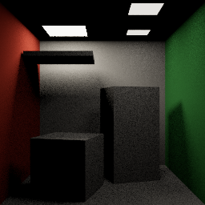
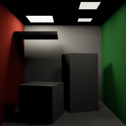

# 最小 RIS 基线：候选变多之后，噪声与成本怎么变

完整可见贡献打分的 RIS 已接入现有路径追踪器。在挡板场景、按功率生成候选时，4 候选 RIS 在相同 128 spp 下把整体亮度 RMSE 降低约 14%，挡板阴影 RMSE 降低约 41%。实际阴影射线数约为原来的 4 倍，采样 GPU 时间约为 1.76 倍。

## 看图

下面是 256 × 256、种子 7、一次散射的实际渲染。表后的误差和计时统计使用 96 × 96。

| 原方法，128 spp | 4 候选 RIS，128 spp | 4 候选 RIS，32 spp |
| --- | --- | --- |
|  |  |  |

## 相同 spp 与相同射线预算

Windows，RTX 4070 SUPER，96 × 96，Vulkan 同步验证开启。以下为三个随机种子的中位数。采样 GPU 时间累加本次历史里的全部采样 dispatch，包含路径追踪和显示变换；显示更新、读回和写盘另计。

| 挡板场景，功率提议分布 | spp | 整体 RMSE | 阴影 RMSE | NEE 阴影射线数 | 采样 GPU ms |
| --- | ---: | ---: | ---: | ---: | ---: |
| 原方法 | 128 | 0.01986 | 0.00463 | 726,865 | 0.627 |
| 4 候选 RIS | 128 | 0.01714 | 0.00273 | 2,907,478 | 1.102 |
| 4 候选 RIS，匹配射线数 | 32 | 0.02531 | 0.00465 | 726,556 | 0.277 |

同射线预算下，RIS 组的整体 RMSE 比原方法高约 27%，阴影误差接近，采样 GPU 时间约为原方法的 44%。32 spp 也减少了相机和 BSDF 延伸射线的采样数，因此要把阴影射线预算、整体误差与总 GPU 时间放在一起评估。

无挡板场景、均匀提议分布和逐种子的原始结果保存在 `output/ris/results.json`。两组场景的整体平均能量中位数与参考图的偏差都在 0.6% 内。

## 这里实现了什么

按[实现计划](../plans/ris-baseline.md)，把原 NEE 项连同其固定 MIS 权重作为被积分的贡献 $F$。单个候选的 RGB 估计为 $C_i=F(X_i)/p(X_i)$，其重采样权重取线性亮度 $w_i=\ell(C_i)$。保留候选 $s$ 后，输出：

$$
C_{\mathrm{RIS}}=C_s\,\frac{\sum_i w_i}{M\,w_s}.
$$

这与阅读笔记中的 $W_Y$ 公式等价。目标函数覆盖完整遮挡结果，权重全零时返回零。BSDF 射线命中光源时仍积累原来互补的 MIS 项。

当目标正是被估计项的亮度时，上式的亮度等于这组候选亮度的平均值。每个候选都已经完成遮挡查询，因此这一步主要建立重采样的正确性基线。后面引入空间或时间复用时，可以用同一场景核对误差与代价。[课程笔记 §3.3，Tip 3.10](https://intro-to-restir.cwyman.org/presentations/2023ReSTIR_Course_Notes.pdf#page=20)

## 验证与接续经验

- **单候选退化检查**。RIS 候选数为 1 时，两个场景和两种提议分布的最大 RGB 差约为 $1.19\times10^{-7}$，阴影射线数完全相同。8 次反弹下最大差约为 $2.38\times10^{-7}$。
- **积分器组合**。五项 CTest、单灯 Cornell 收敛／能量回归通过。GGX 金属场景的 4 候选 RIS 对照已保留的 4096 spp BSDF-only 参考，三个立方体面的能量比落在 0.9826–1.0084。
- **参考误差**。沿用多灯基线的 16,384 spp BSDF-only 参考，并以独立的 8,192 spp 图交叉检查。有挡板参考间 RMSE 为 0.01024，因此误差表同时包含参考图的有限采样噪声。阴影区域仍使用下半画面中比无挡板参考暗至少 40% 的 1,748 个像素。
- **计数与计时**。蓄水池替换使用独立随机数流，便于单候选对照。重复读回和达到采样上限后的显示 dispatch 都通过测试，不会重复计入采样 GPU 时间。多灯场景的精确射线计数要求 spp × 反弹上限 × 每点候选数不超过 $2^{24}$，程序会检查这个范围。

当前蓄水池保留已计算的 RGB 贡献与权重。后续做时空复用时，需要为被选样本保存灯索引和灯面位置，并在接收像素重新评价目标函数、可见性和贡献权重。这些将接在[第二篇阅读笔记](../reading/restir-ris.md)之后单独规划。

## 复现

在项目根目录运行：

```powershell
./tools/build.ps1 -Test
python tests/validate_ris.py build/Release/raytrace.exe
./build/Release/raytrace.exe --scene many-lights-occluded --light-sampling power --ris-candidates 4 --spp 128 --max-bounces 1
```

`--ris-candidates 0` 使用原直接光照积分器，1–64 指定每个着色点的候选数。现有 `--light-sampling` 参数控制候选提议分布。逐次运行的 PFM、参数元数据、验证日志与统计位于 `output/ris/`。
