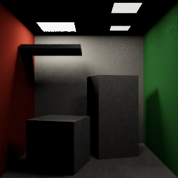

# 静态空间复用：邻居样本带来了多少收益

两阶段空间复用已经完成。在同为 128 spp、每像素四个初始候选时，挡板场景的整体亮度 RMSE 比独立 RIS 降低约 4.5%，阴影区域降低约 24%。完整交叉权重检查让 NEE 阴影射线数增至约 3.88 倍，GPU 采样时间增至约 3.06 倍。

## 实际画面

下面是 256 × 256、种子 7 的一次散射渲染。统计表使用 96 × 96，因此第三张图展示相同配置下的低 spp 画面，具体预算匹配以统计表为准。

| 独立 RIS，128 spp | 四邻居空间复用，128 spp | 四邻居空间复用，33 spp |
| --- | --- | --- |
|  |  |  |

## 预算与误差

Windows，RTX 4070 SUPER，Vulkan 同步验证开启。功率提议分布，初始四候选，四个邻居位于屏幕上下左右各两个像素处。三组种子取中位数。两种方法都使用每帧 1 spp，GPU 时间累加完整采样过程。

| 挡板场景 | spp | 整体 RMSE | 阴影 RMSE | NEE 阴影射线数 | 采样 GPU ms |
| --- | ---: | ---: | ---: | ---: | ---: |
| 独立 RIS | 128 | 0.01714 | 0.00273 | 2,907,478 | 2.000 |
| 四邻居空间复用 | 128 | 0.01638 | 0.00206 | 11,289,909 | 6.118 |
| 空间复用，匹配阴影射线预算 | 33 | 0.02389 | 0.00285 | 2,908,421 | 1.575 |

匹配阴影射线数后，整体误差比独立 RIS 高约 39%，GPU 时间约为原来的 79%。无挡板场景的相同预算对照也出现了整体误差升高。各组种子的实际射线预算差均小于 0.15%。原始记录见 `output/spatial/results.json`。

## 正确性与收敛

零邻居经过同一套两阶段流程，与原独立 RIS 的最大 RGB 差为 $2.38\times10^{-7}$，阴影射线数完全相同。

在挡板场景、固定种子 97 下，空间复用逐帧独立生成新蓄水池，累积结果如下：

| 累积 spp | 整体 RMSE | 阴影 RMSE |
| --- | ---: | ---: |
| 8 | 0.05123 | 0.00485 |
| 64 | 0.01840 | 0.00238 |
| 512 | 0.00855 | 0.00180 |
| 2048 | 0.00642 | 0.00170 |

2048 spp 时，整体平均能量比为 0.99944，阴影区域为 1.00094。参考与掩码沿用[多光源实验](./many-light-sampling.md)，16,384 spp 的 BSDF-only 参考图也有有限采样噪声。

五项 CTest、单灯积分器回归、空间模式的重放／相机重置／曝光与采样上限测试、65 × 49 非整工作组检查均通过。同步验证日志中没有验证错误。这些结果覆盖 Windows 桌面。

## 这次保留下来的经验

第一阶段把表面信息、灯面样本和贡献权重写进每像素 128 字节的缓冲区。第二阶段只读这些初始蓄水池，在接收表面重新评价样本，输出最终光照。缓冲区在 96 × 96 时占 1.125 MiB，512 × 512 时占 32 MiB。

空蓄水池也可能来自一个仍有贡献区域的分布，因此其来源表面继续参与其他候选的 MIS 分母。固定邻域的选择基于屏幕位置和主交点状态。这落实了[第三篇阅读笔记](../reading/restir-reuse.md)中的支持域要求。

当前实现对候选做完整交叉目标函数评价，包含遮挡查询，成本随来源数增加很快。局部阴影确实更平滑，但这两个场景里，近似相同阴影射线预算下的整体误差都升高了。它为后续历史复用和权重计算优化提供了可复查的正确性基线。

## 复现

在项目根目录运行：

```powershell
./tools/build.ps1 -Test
python tests/validate_spatial.py build/Release/raytrace.exe
./build/Release/raytrace.exe --scene many-lights-occluded --light-sampling power --ris-candidates 4 --spatial-neighbors 4 --samples-per-frame 1 --max-bounces 1 --spp 128
```

空间实验通过启动参数设置采样，窗口保留相机、曝光和保存快捷键。`--spatial-neighbors 0` 可运行零邻居对照。该模式要求每帧 1 spp、一次散射和原始路径视图，采样与空间缓冲区之间的同步由 Vulkan 后端处理。[实现计划](../plans/spatial-reuse.md)

## 视口键盘输入修复

2026-11-13 实测发现，中文输入法会把 W 等字母键送进组合框，GLFW 的 Windows 输入实现跳过了这些 `VK_PROCESSKEY` 事件。修复在创建渲染视口时取消它的输入法上下文关联，同时开启 GLFW 按键锁存，让帧间短按也能被处理。[Windows 输入法上下文 API](https://learn.microsoft.com/en-us/windows/win32/api/imm/nf-imm-immassociatecontextex)

在实际桌面窗口中验证了 W、R、P。W 让相机 Z 从 3.5 变为 3.49567，并重新累积；R 恢复到 3.5；P 正常保存图像与相机元数据。验证记录位于 `output/keyboard/`，五项 CTest 通过。
